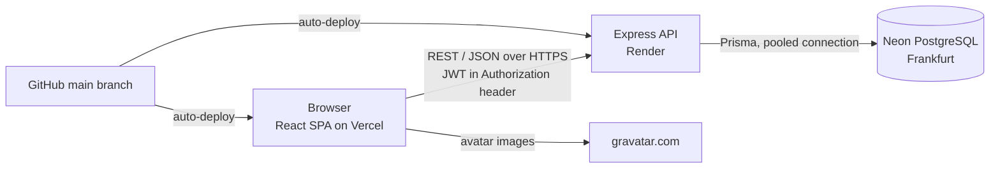
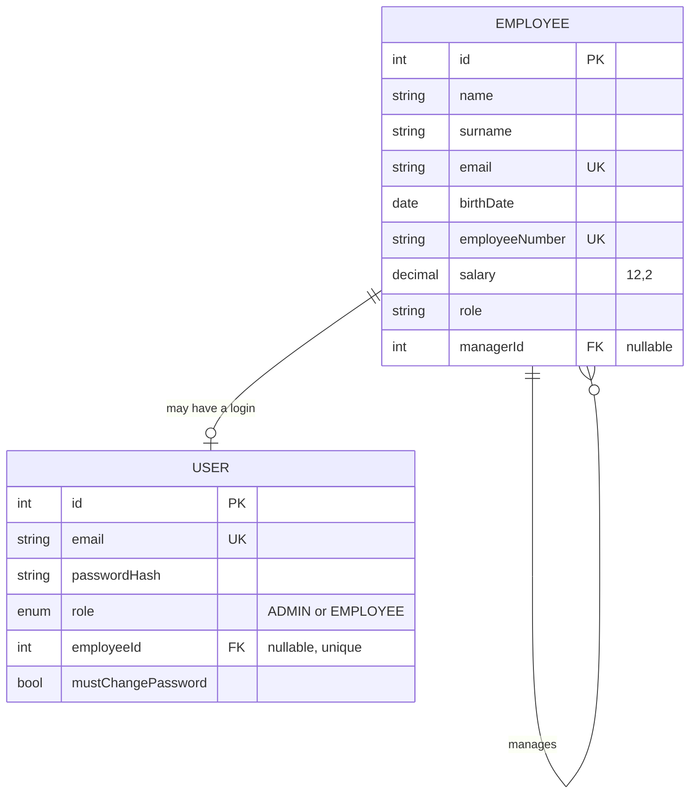

# SkyBranch Technical Document

**Author:** Chinmayi Santhosh  
**Repository:** https://github.com/ChinmayiSanthosh/SkyBranch  
**Live app:** https://sky-branch.vercel.app · **API health check:** https://skybranch-api.onrender.com/api/health

## 1. Overview

SkyBranch is a cloud-hosted web application for managing an organisation's employee hierarchy. A user can create, read, update and delete employees, set each person's reporting line manager, see the organisation as a tree, and sort and filter everyone in a table. Gravatar supplies avatar pictures.

Everything is stored in a remote PostgreSQL database. Nothing is mocked, hardcoded or read from local files.

Two kinds of account exist. **Administrators** manage everything. **Employees** get a view-only account in which salaries are hidden. Both are described in section 8.

## 2. Architecture



The frontend is a single-page application served as static files by Vercel. It talks to the API over HTTPS using JSON. The API is a stateless Node/Express service on Render, so any instance can serve any request. It reaches the database through Prisma. Gravatar images are loaded by the browser directly from gravatar.com.

The repository is a **monorepo** managed with npm workspaces: `apps/api`, `apps/web` and `docs` live together, so one link covers everything, one change can span the API and the interface, and one set of conventions applies to both.

## 3. Technologies and justification

| Technology | Why it was chosen |
|---|---|
| **TypeScript, Node.js 22 end to end** | One language across the frontend and backend, so there is a single mental model. Static types catch many mistakes before the code runs |
| **React 19 + Vite 8** | A component model that fits atomic design. Vite gives fast builds and plain static output that Vercel can host |
| **Hand-built SVG tree** | No charting dependency, full control over the look (branches that taper, a horizon line, a flip option), and each person is a real button for keyboard and screen-reader use |
| **CSS Modules + design tokens** | Styles are scoped to their component, while colours, radii and glass effects are shared variables. That made the dark theme a matter of overriding variables |
| **Express** | Minimal and widely understood. The API is small, so a larger framework would add ceremony without benefit |
| **zod** | One schema both validates input and gives typed data |
| **PostgreSQL on Neon** | A hierarchy is naturally a self-referencing relation, which a relational database enforces with a foreign key and constraints. Neon is managed, serverless and has a free tier, so the database is live and hosted |
| **Prisma 7** | Typed queries and versioned migrations, so the schema can be rebuilt from the repository. The Neon driver adapter connects through the pooled connection, and migrations use the direct one |
| **JWT + bcrypt** | Stateless authentication that suits a separately hosted API. bcrypt stores slow, salted hashes, never passwords |
| **Gravatar** | Required by the brief. The browser hashes the email, so the plain email is never sent to Gravatar |
| **Render, Vercel, Neon** | All connect to GitHub, auto-deploy, and give HTTPS URLs with almost no setup (see section 11) |

## 4. Design patterns

| Pattern | Where it is used |
|---|---|
| **Layered architecture** | The API flows routes → controllers → services → Prisma. Routes map URLs to controllers, controllers handle the request and response, services hold the business rules, and Prisma is the data-access layer |
| **Middleware chain** | `requireAuth`, `requireAdmin`, `requireReadyAccount`, `validate` (zod), `asyncHandler` and a central `errorHandler` |
| **DTO mapping** | The service layer converts database rows into the shape the API sends. This is where salary is removed for non-administrators |
| **Custom error type** | `HttpError` carries a status code. Prisma unique-constraint errors become HTTP 409 |
| **Atomic design** | Frontend components are organised as atoms, molecules, organisms, templates and pages |
| **Context provider** | `AuthContext` holds the session and is shared across the app |
| **Custom hooks** | `useEmployees`, `usePanZoom`, `useActiveSection`, `usePermissions`, `useTheme` |
| **Typed API client** | One `services/api.ts` wrapper around `fetch`, so components never build requests themselves |

## 5. Data model



- **Employee** has `createdAt` and `updatedAt` timestamps and an index on `managerId`. The hierarchy is a self-relation. A null `managerId` marks the top of the organisation.
- **User** is deliberately separate from Employee: Employee means a person in the org chart, User means a person who may sign in. An employee's login is linked through `employeeId` and is deleted with the employee. The `mustChangePassword` column exists but is currently always false.
- Migrations are versioned in `apps/api/prisma/migrations` (the first is `init`).

### Business rules enforced in the service layer

- The manager must exist. Nobody can be their own manager. Circular chains (A manages B manages A) are rejected. The manager may be empty.
- **Deleting an employee** moves their direct reports up to the deleted person's manager, inside a database transaction.
- **Employee numbers** are generated by the server in the form E001, E002 and so on (the highest existing number plus one, retried if two people are added at once). Clients cannot set or change them.
- **Validation:** the birth date cannot be in the future, and the person must be between 18 and 100 years old. Salary must be above 500. Email must be valid, required fields must be present, and lengths are limited. The form applies the same rules for fast feedback, but the API is the authority.

## 6. API reference

| Method | Path | Purpose | Access |
|---|---|---|---|
| GET | `/api/health`, `/api/health/db` | Health checks | Public |
| POST | `/api/auth/login` | Exchange credentials for a token | Public |
| POST | `/api/auth/signup` | Employee creates their own login | Public, only for an email that is already an employee |
| POST | `/api/auth/register` | Create an administrator login | Open only while no user exists; afterwards administrators only |
| GET | `/api/auth/me` | The signed-in user | Signed in |
| POST | `/api/auth/change-password` | Change own password | Signed in (API only, no screen yet) |
| GET | `/api/employees` | List employees, optional `?search=` across name, surname, email, number and role | Signed in. Salary is `null` for employees |
| GET | `/api/employees/hierarchy` | The nested tree | Signed in. Salary is `null` for employees |
| GET | `/api/employees/:id` | One employee | Signed in. Salary is `null` for employees |
| POST | `/api/employees` | Create | Administrators |
| PATCH | `/api/employees/:id` | Update | Administrators |
| DELETE | `/api/employees/:id` | Delete, reassigning reports | Administrators |

## 7. The tree layout in plain language

Every employee becomes a node. The layout works from the bottom up: people with no reports take the next free space along the row, and each manager is centred above the span of their team. Depth in the hierarchy decides the vertical level. Branches are smooth curves from a manager to each report, and they get thinner with depth. A trunk and a horizon line make it read as a tree standing on the ground, and "Flip tree" mirrors the vertical direction for a conventional top-down chart.

The view can be panned by dragging and zoomed with buttons or Ctrl + scroll (plain scrolling still scrolls the page). It is clamped so the tree can never be dragged or zoomed out of its canvas, and "Fit" frames the whole tree. Because it is plain SVG with React state, it needs no extra library.

## 8. Authentication, authorisation and security

### Accounts and roles

| | Administrator | Employee |
|---|---|---|
| Created by | An existing administrator, or the first account on an empty database | The employee, at `/signup`, with a password they choose |
| Salary | Visible | Never sent. The API returns `null` |
| Add, edit, delete | Allowed | Refused with 403 |

**Employee sign-up** only accepts an email that already exists in the employee table, and each employee can have one login. The new account is created with the `EMPLOYEE` role and linked to the employee record. There is no open registration, because anyone could otherwise create an account and read the organisation's data.

**Privacy is enforced on the server.** Hiding salaries only in the interface would not be enough, since anyone could call the API directly. The service layer removes the salary from every response to a non-administrator, and the routes refuse any change from a non-administrator. The interface mirrors this by hiding the salary column and filter, the salary row in the details panel, the average-salary statistic, and the Add, Edit and Delete controls, and by showing a banner that says the account is an employee account. Birth date and email remain visible to employees.

### Measures

| Concern | Approach |
|---|---|
| Passwords | Hashed with bcrypt (12 rounds). Never stored or returned in plain text |
| Sessions | Signed JWT, 8 hour expiry. The user is reloaded from the database on every request, so a deleted account or changed role takes effect immediately |
| Brute force | Login, sign-up, register and change-password are rate limited (20 attempts per 15 minutes) |
| Account enumeration | A wrong email and a wrong password give the same message |
| Headers | `helmet` |
| CORS | Locked to the frontend origin through `CORS_ORIGIN` (open only when unset, for local development) |
| Input | Validated on the server with zod for every write, plus manager and hierarchy rules |
| SQL injection | Prisma uses parameterised queries |
| Secrets | Held in environment variables. `.env` is git-ignored and only `.env.example` is committed |
| Transport | HTTPS on all hosts |
| Gravatar | The email is hashed in the browser (SHA-256), so the plain email is never sent |

## 9. Frontend structure

```
src/
├── components/
│   ├── atoms/        Button, Input, Select, Logo, Avatar, NavButton ...
│   ├── molecules/    FormField, SearchBox, SortableHeader, Modal, NavMenu, TreeNodeCard, ZoomControls, RoleBanner, ThemeToggle ...
│   ├── organisms/    LoginForm, SignupForm, AppHeader, EmployeeForm, EmployeeTable, EmployeeDetailPanel, HierarchyTree, CanopySection, RosterSection, AboutSection ...
│   └── templates/    AuthLayout, AppLayout
├── pages/            LoginPage, SignupPage, HomePage
├── context/          AuthContext
├── hooks/            useEmployees, usePanZoom, useActiveSection, usePermissions, useTheme
├── services/         api.ts (typed fetch wrapper), types.ts
├── utils/            tree layout, validation, formatting, scrolling
└── styles/           tokens.css (design variables), global.css
```

After sign-in, the app is one scrolling page with three sections: **Canopy** (tree), **Roster** (table) and **About**. A sticky header with a floating menu highlights the current section and respects `prefers-reduced-motion`. The About section shows live statistics from the database (people, managers, levels deep and distinct roles, plus the average salary for administrators).

**Theming.** Colours, radii and glass effects are variables in `tokens.css`. A dark theme overrides those variables, switched by a `data-theme` attribute on the page, chosen with a header toggle, remembered in the browser, and defaulting to the system setting.

**Gravatar.** The browser hashes the trimmed, lowercased email with SHA-256 and requests `gravatar.com/avatar/<hash>?d=404`. If no picture exists the request fails and the person's initials are shown.

**Table.** Sorting and filtering happen in the browser, which is fine for hundreds of employees. Very large organisations would need server-side pagination. The salary filter understands `>`, `>=`, `<`, `<=` and `=`.

## 10. Build and deployment

| Part | Platform | Details |
|---|---|---|
| Database | Neon (free), project `skybranch`, AWS Frankfurt | Pooled connection for the app, direct connection for migrations. Compute scales to zero when idle and wakes in a second or two |
| API | Render (free web service), Frankfurt | Auto-deploys from `main`. Build `npm ci --include=dev && npm run build --workspace apps/api`, start `npm run start --workspace apps/api`. Variables: `DATABASE_URL`, `DATABASE_URL_UNPOOLED`, `JWT_SECRET`, `NODE_VERSION`, `CORS_ORIGIN` |
| Frontend | Vercel | Root `apps/web`, Vite preset, variable `VITE_API_URL`, and a `vercel.json` rewrite so refreshing a client route does not 404. Preview deployments per branch |

The API build runs `prisma generate && tsc`, then a `postbuild` step copies the generated Prisma client into `dist`, because `tsc` skips already-compiled files. The server starts with `node dist/index.js`.

**Free-tier cold starts.** Render's free instances sleep after about 15 minutes idle and take roughly 50 seconds or more to wake. Rather than hide this, the interface shows a "waking up the server" message if the API takes more than 2.5 seconds to answer. Other options are a free uptime monitor pinging `/api/health/db` every five minutes, or Render's paid instance (neither is set up).

## 11. Why Render, Vercel and Neon, and not AWS

AWS was considered. New AWS accounts now get a credit-based free plan that expires, activation can take time, and the setup (networking, HTTPS, containers) is much heavier for a solo first full-stack project on a three-day deadline. Neon itself runs on AWS infrastructure. Render and Vercel connect to GitHub, deploy automatically and provide HTTPS URLs with almost no setup, which let the time go into the product instead of the hosting.

## 12. Development process, challenges and decisions

**Process.** A monorepo with a deployed `main` branch and a `dev` branch, short-lived feature branches merged by pull request, conventional commit messages, migrations versioned in git, and secrets never committed. Testing has been manual: requests against the API for each rule and failure case, and click-through testing of the interface for both account types. **There are no automated tests and no CI pipeline yet.** They are listed under future work.

| Challenge | Resolution |
|---|---|
| TypeScript 7 conflicted with `typescript-eslint`'s allowed range | Pinned TypeScript to 5.9 |
| `npm ci` failed on Render because the lockfile held an old workspace name | Regenerated the lockfile. This is also why the hosts use `npm ci`, for reproducible installs |
| `tsc` does not copy the generated Prisma client into `dist` | Added a `postbuild` copy step |
| `dotenv`'s types did not resolve with the old module setting | Moved to Node16 module resolution |
| Generic validation messages on login | Separated the login schema from the register schema |
| A stuck "Please wait" button | A missing `finally` block |
| The wake-up banner never cleared | Its timer was not being cancelled |
| Free-tier cold starts | Designed around them with a banner instead of hiding them |

**Key decisions.** Rules live on the server and are mirrored on the client, so the API stays safe whatever calls it. Employee and User are separate tables so that being in the org chart never grants access. Salary privacy is enforced in the API response, not just the interface. Employee numbers are generated by the server so they stay unique and consistent.

## 13. Extra features beyond the brief

- Auto-generated, unique employee numbers
- Age (18 to 100) and salary validation on server and form
- Circular reporting-chain detection
- Reassignment of direct reports when someone is deleted
- Tree flip, pan, zoom and fit, with search highlighting and Enter-to-cycle
- Salary filter operators (`>`, `>=`, `<`, `<=`, `=`) and per-column filters
- Employee sign-up with a view-only role and server-enforced salary privacy
- Light and dark themes
- About section with live organisation statistics
- Wake-up banner for free-tier cold starts
- Rate limiting, helmet headers and CORS lock-down

## 14. Known limitations and future work

| Limitation | Notes and possible fix |
|---|---|
| Not built: avatar upload | Optional in the brief. Plan: store a small resized image in the database and show uploaded picture, then Gravatar, then initials |
| Employee sign-up has no email verification | The first person to register a given work email owns that login, and there is no administrator screen to reset or remove a login (deleting the employee removes it). An email service would allow verification and password reset |
| Single administrator role | No finer-grained roles, for example managers who may see their own team's salaries |
| Change-password has an API endpoint but no screen | Low effort to add |
| Token stored in `localStorage` | Readable by injected scripts. `httpOnly` cookies are stronger |
| Sorting and filtering in the browser | Server-side pagination would be needed for very large organisations |
| Employee numbers can be reused | If the newest employee is deleted, their number can be issued again. A dedicated counter would fix this |
| No automated tests or CI | Next step: unit tests for the hierarchy rules and a GitHub Actions workflow running build and lint |
| No Swagger / OpenAPI documentation | The endpoint table in section 6 stands in for it |
| Free-tier cold starts | Mitigated by the banner. An uptime monitor or paid instance would remove them |
| One database for local and live use | Neon branches would separate them |