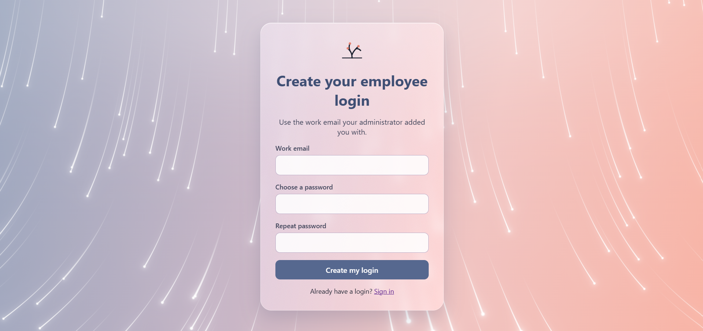
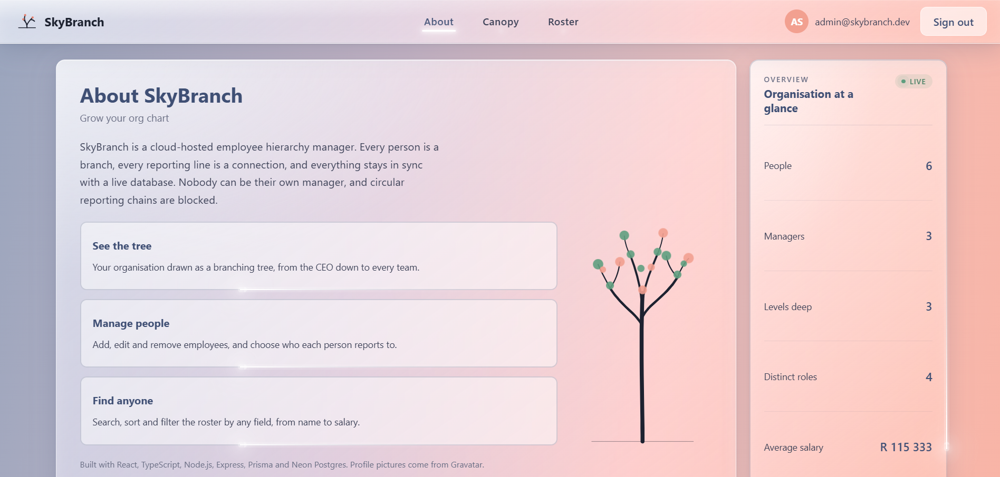
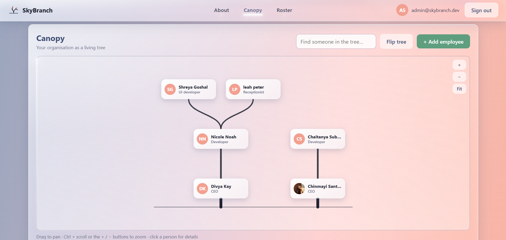
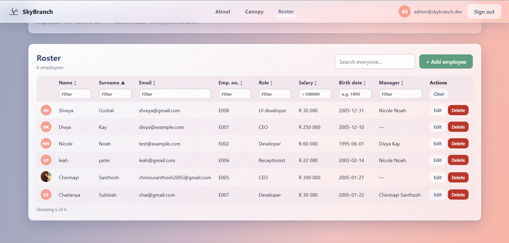

# SkyBranch User Guide

SkyBranch shows your organisation as a tree and lets you manage the people in it. This guide explains every feature, step by step.

**Live app:** https://sky-branch.vercel.app

## Contents

1. [Who can use it](#1-who-can-use-it)
2. [Opening the app and the waking-up message](#2-opening-the-app-and-the-waking-up-message)
3. [Signing in](#3-signing-in)
4. [Creating an employee login](#4-creating-an-employee-login)
5. [The header, navigation and About section](#5-the-header-navigation-and-about-section)
6. [Canopy: the tree](#6-canopy-the-tree)
7. [Adding an employee](#7-adding-an-employee)
8. [Editing an employee](#8-editing-an-employee)
9. [Deleting an employee](#9-deleting-an-employee)
10. [Roster: the table](#10-roster-the-table)
11. [Pictures (Gravatar)](#11-pictures-gravatar)
12. [Light and dark mode](#12-light-and-dark-mode)
13. [Signing out](#13-signing-out)
14. [Messages and what they mean](#14-messages-and-what-they-mean)
15. [Troubleshooting](#15-troubleshooting)

## 1. Who can use it

There are two kinds of account.

| | Administrator | Employee |
|---|---|---|
| See the tree and the table | Yes | Yes |
| See salaries | Yes | No |
| Add, edit and delete people | Yes | No |

Employees are the people shown in the organisation. They are not automatically able to sign in. An employee creates their own login once (section 4).

## 2. Opening the app and the waking-up message

Open the address above in any modern browser.

The app runs on free hosting that goes to sleep when nobody has used it for a while. The first visit after a quiet spell can take about a minute. If the server is slow to answer, a message on the login page tells you that it is waking up. **Wait for it.** The page carries on by itself and does not need a refresh.

## 3. Signing in

1. Type your **email** and **password**.
2. Select **Sign in**.

If the details are wrong, a message appears and you can try again. You stay signed in for 8 hours, or until you sign out.

## 4. Creating an employee login

This is for employees only. Administrators receive their login from whoever runs the system.

1. On the login page, select **Create your login** (or go to `/signup`).
2. Type your **work email**. It must be the same email your administrator used when adding you to SkyBranch.
3. Choose a **password** of at least 8 characters, and type it again to confirm.
4. Select **Create my login**.

You are signed in straight away. If the email is not in the system, ask your administrator to add you. If an account already exists for the email, use **Sign in** instead.

When you are signed in as an employee, a banner at the top reminds you that the account is view-only: salaries are hidden and you cannot add, edit or delete anyone.

## 5. The header, navigation and About section

The header stays at the top as you scroll.

- **SkyBranch** and the logo are on the left.
- The **menu** in the middle has three sections: **Canopy** (the tree), **Roster** (the table) and **About**. Select one to scroll smoothly to it. The section you are looking at is highlighted.
- On the right are your **account**, a **Light mode / Dark mode** button, and **Sign out**.

The whole app is one page you can scroll through.

### About

The About section explains what SkyBranch is and shows live figures from the database: how many people there are, how many are managers, how many levels deep the organisation goes, how many distinct roles there are, and (for administrators) the average salary.

## 6. Canopy: the tree

The Canopy shows the organisation as a tree. The person at the top has no manager, and everyone else hangs from their manager. Thicker branches are higher up.

### Moving around

| To do this | Do this |
|---|---|
| Pan | Click and drag on the tree |
| Zoom | Use the **+** and **−** buttons, or hold **Ctrl** and scroll. Plain scrolling still scrolls the page |
| See the whole tree | Select **Fit** |
| Flip the tree | Select **Flip tree** to switch between a tree that grows upward and a conventional top-down chart |

The tree cannot be dragged or zoomed out of its frame, so you cannot lose it.

### Looking at a person

Click a person. The view glides to them and a **details panel** opens beside the tree (below it on a narrow screen). It shows their employee number, email, birth date, manager and number of direct reports. Administrators also see the salary, plus **Edit** and **Delete** buttons. Select **×** to close the panel.

### Searching the tree

Type in **Find someone in the tree…**. Matches are highlighted and everyone else is dimmed, and the view glides to the first match. Press **Enter** to jump to the next match. You can search by name, surname, email, employee number or role. Clear the box to return to normal.

## 7. Adding an employee

*Administrators only.*

1. Select **+ Add employee** in the Canopy or the Roster.
2. Fill in the form:

| Field | Rules |
|---|---|
| Name and surname | Required |
| Email | Required, in a valid format, and not already used by another employee. It is also used for the picture (section 11) |
| Birth date | Cannot be in the future. The person must be at least 18 and no more than 100 years old |
| Salary | Must be above 500 |
| Role | Required (their position or job title) |
| Manager | Choose who the person reports to, or leave it empty for the top of the organisation. A person cannot be their own manager |

3. Select **Save**.

The **employee number** is assigned automatically (E001, E002 and so on). You cannot type or change it.

If something is wrong, a message appears under the field concerned. Fix it and save again. The new person appears in the tree and the table straight away.

## 8. Editing an employee

*Administrators only.*

1. Select the person in the tree, then **Edit**. In the Roster, use the **Edit** button on their row.
2. Change what you need and select **Save**.

Changing someone's manager moves them, and everyone who reports to them, to the new branch. The manager list leaves out the person you are editing, and the system refuses any change that would make a loop (for example, two people managing each other, directly or through a chain).

If the person has a login, it follows their email address when you change it.

## 9. Deleting an employee

*Administrators only.*

1. Select the person, then **Delete**.
2. Confirm when asked.

**What happens to their team:** people who reported to the deleted person move up to the deleted person's manager, so nobody is left without a place in the tree. If the person had a login, it is deleted with them.

## 10. Roster: the table

The Roster lists everyone with their name, surname, email, employee number, role, salary (administrators only), birth date and manager.

| To do this | Do this |
|---|---|
| Sort | Select a column heading. Select it again to reverse the order |
| Filter one column | Type in the box under the heading. Several filters work together |
| Search everything at once | Use **Search everyone…** above the table |
| Clear all filters | Select **Clear** at the end of the filter row |

The footer shows how many people match, for example "Showing 4 of 12".

### Filtering salary

*Administrators only.* The salary filter accepts a plain number, or a comparison:

| Type | Finds |
|---|---|
| `>100000` | Salaries above 100000 |
| `>=100000` | 100000 or more |
| `<50000` | Below 50000 |
| `<=50000` | 50000 or less |
| `=75000` | Exactly 75000 |

Birth date filters match part of the date, so `1995` finds everyone born in 1995.

## 11. Pictures (Gravatar)

Pictures come from Gravatar, a free service that links a picture to an email address. If an employee has no Gravatar, their **initials** are shown instead.

To get a picture to appear:

1. Go to [gravatar.com](https://gravatar.com) and sign up with the **same email** that is stored in SkyBranch.
2. Upload a picture there.
3. Reload SkyBranch. It can take a few minutes for a new picture to show.

SkyBranch never sends the plain email address to Gravatar.

## 12. Light and dark mode

Select **Dark mode** (or **Light mode**) in the header. The app remembers your choice on that device. The first time you visit, it follows your device's setting.

## 13. Signing out

Select **Sign out** in the header. You return to the login page. Do this on a shared computer.

## 14. Messages and what they mean

| Message | What it means and what to do |
|---|---|
| Incorrect email or password | One of them is wrong. The same message appears for both, on purpose. Try again |
| Too many attempts, please try again later | Too many sign-in attempts. Wait 15 minutes |
| We could not find an employee with this email | Sign-up only works for emails that are in the system. Check the spelling, or ask your administrator to add you |
| An account already exists for this email | You already created a login. Use **Sign in** |
| Authentication required, or Invalid or expired token | Your session ended. Sign in again |
| Only administrators can do this | Your account is view-only |
| An employee with this email already exists | Every employee needs a different email |
| An employee cannot be their own manager | Choose a different manager, or none |
| This change would create a circular reporting chain | The manager you chose already reports to this person, directly or through others. Choose someone else |
| The selected manager does not exist | The manager was removed. Choose another |
| Employee not found | The person was deleted. Reload the page |
| Could not reach the server | The server may be waking up, or your connection dropped. Wait a minute and try again |

Messages about age and salary appear under the field. The person must be 18 to 100 years old, and the salary must be above 500.

## 15. Troubleshooting

| Problem | What to try |
|---|---|
| The first page load is very slow | The free server is waking up. Wait up to a minute |
| I cannot sign in | Check your email and password. If you are an employee and have not made a login yet, see section 4 |
| I cannot see salaries, or the Add, Edit and Delete buttons are missing | You are signed in with an employee (view-only) account. Administrators see them |
| A new picture does not appear | Gravatar must be set up with the same email (section 11). Wait a few minutes and reload |
| The tree looks lost or too small | Select **Fit** |
| Something looks out of date | Reload the page. If that does not help, hold **Ctrl + Shift + R** |